 

## About

I'm a data analyst with internship experience at **Kryptora (2023 to 2024)**, where I extracted, cleaned and queried operational datasets using **SQL and Python**, then turned them into visuals and reports in **Excel and Power BI** for cross-functional teams and leadership.

I'm looking for **Data Analyst, BI Analyst or MIS Reporting** roles.

## Toolkit

| Area | Tools |
|---|---|
| **Querying** |  |
| **Analysis** |    |
| **Dashboards** |   |
| **MIS reporting** | Pivot Tables, VLOOKUP / XLOOKUP, Google Sheets, formula-based reporting |
| **Version control** |   |

## Projects

| Status | Project | Description |
|---|---|---|
| 🟡 In progress | **Data Cleaning & Visualization Portfolio** | SQL queries, Python EDA, and Excel / Power BI dashboards on public datasets |
| 🟡 In progress | **Operational MIS & Reporting Sheet** | Excel tool for daily logging, shift tracking and automated summaries using formulas and pivots |

<!--
WHEN A PROJECT HAS A REAL REPO, change its row to:
| 🟢 Done | [**Project name**](https://github.com/DeepankarSingh14/REAL-REPO-NAME) | one-line result, e.g. what question it answers |
Only link repos that exist and have a README with screenshots.
-->

## Certifications

IBM / Cognitive Class: Data Science 101 · Data Science Foundations Level 1 · Python for Data Science · Data Analysis with Python · Data Visualization with Python · Applied Data Science with Python Level 2 · SQL and Relational Databases 101 · Prompt Engineering for Everyone (AI Guild)

**Contact:** [LinkedIn](https://www.linkedin.com/in/deepankar-singh-9399b8165/) · [Kaggle](https://www.kaggle.com/deepankars1406) · [Portfolio](https://deepankar-singh-data-analyst.ai.studio/) · [Email](mailto:deepankar157@gmail.com)

